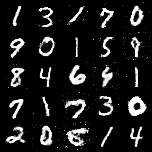

# Generative Adversarial Network (GAN) Project

A small PyTorch project with two experiments:

- **GAN** – trains a generator/discriminator pair on MNIST to produce handwritten digits.
- **Classifier** – trains an MLP classifier on FashionMNIST.



## Project Structure
- `models/` - Model definitions
  - `generator.py` - `Generator` (MLP) and `Generator_cnn` (transposed-conv, DCGAN-style)
  - `discriminator.py` - MLP discriminator (outputs logits)
  - `classifier.py` - MLP classifier (outputs logits)
- `train/` - Training scripts
  - `train_gan.py` - GAN training and sampling
  - `train_classifier.py` - Classifier training and evaluation
- `utils.py` - Shared transform, seeding and plotting helpers
- `main.py` - Shortcut for `train/train_classifier.py`
- `Resources/` - Sample output used in this README
- `requirements.txt` - Python dependencies

Generated at runtime (git-ignored):
- `data/` - Datasets, downloaded automatically
- `checkpoints/` - Saved model weights
- `images/` - Sample grids, predictions and loss curves

## Setup Instructions
1. (Recommended) Create a virtual environment:
   ```bash
   python3 -m venv venv
   source venv/bin/activate
   ```
2. Install dependencies:
   ```bash
   pip install -r requirements.txt
   ```

## Usage
Run the commands from the repository root.

Train the GAN, then generate a grid of samples:
```bash
python train/train_gan.py --epochs 50
python train/train_gan.py --generator mlp   # use the MLP generator instead of the CNN one
python train/train_gan.py --test-only       # only sample from checkpoints/generator.pth
```

Train and evaluate the classifier:
```bash
python train/train_classifier.py --epochs 10
python train/train_classifier.py --test-only   # only evaluate checkpoints/classifier.pth
```

Both scripts accept `--batch-size`, `--lr`, `--device`, `--seed`, `--num-workers`,
`--data-dir`, `--checkpoint-dir` and `--image-dir`. Run with `--help` for details.

## Requirements
- Python 3.8+
- PyTorch, torchvision, torchmetrics
- matplotlib, numpy

## References
- [GAN Paper (Goodfellow et al., 2014)](https://arxiv.org/abs/1406.2661)
- [DCGAN Paper (Radford et al., 2015)](https://arxiv.org/abs/1511.06434)
- [PyTorch DCGAN Tutorial](https://pytorch.org/tutorials/beginner/dcgan_faces_tutorial.html)
